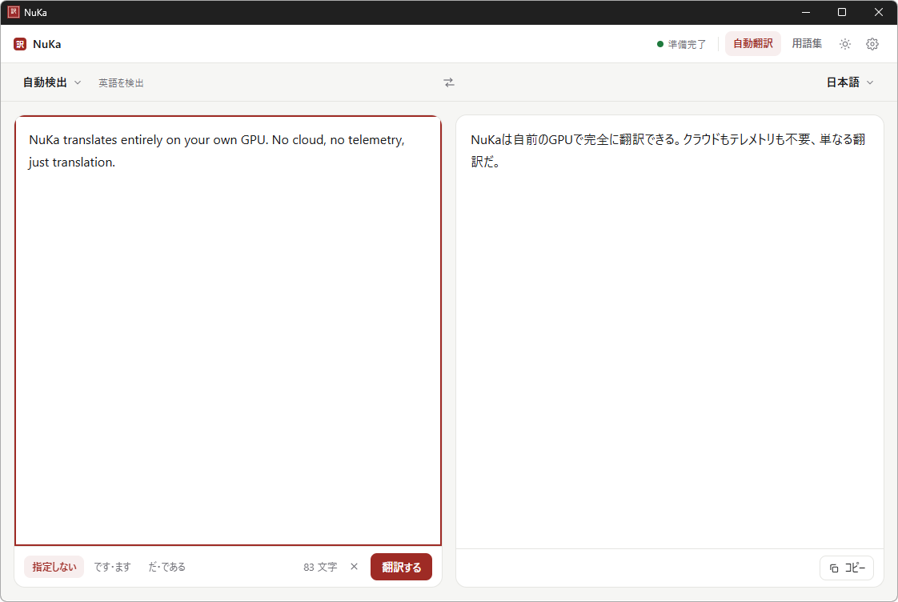
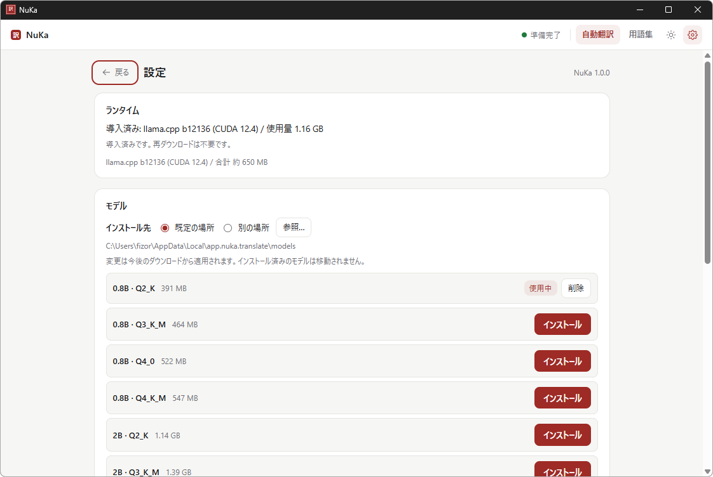

<div align="center">


# NuKa

**手元の GPU で、53 言語を、その場で。**
*A local-first translation desktop app — llama.cpp + PLaMo 3 Translate, on your own GPU.*

**入力したテキストはどこにも送信されません / Nothing ever leaves your machine.**

[](https://github.com/Fizor-drm/NuKa/releases/latest)
[](LICENSE)


[ダウンロード / Download](https://github.com/Fizor-drm/NuKa/releases/latest) · **日本語** · [English](#english) · [中文](#中文)



</div>

---

## 日本語

### これは何

入力したテキストを、**自分の PC の中だけで**訳すデスクトップアプリです。翻訳エンジンは llama.cpp、モデルは PLaMo 3 Translate (PFN 公式 GGUF・14 種から選択)。原文も訳文も外部に送られません。

### 特徴

| | |
|---|---|
| **完全ローカル** | クラウドもテレメトリもなし。オフラインで動く |
| **53 言語** | 日本語・英語・中国語 (簡体/繁体)・韓国語・ドイツ語・フランス語など |
| **モデルを選べる** | 0.8B〜31B × 量子化 14 種。設定画面からインストール・切り替え |
| **用語集と文体** | 訳語の固定、日本語訳の「です・ます / だ・である」 |
| **自動翻訳** | 入力が止まったらすぐ訳して、ストリーミング表示 |

### インストール

1. [リリース](https://github.com/Fizor-drm/NuKa/releases/latest) から `NuKa_1.0.0_x64-setup.exe` を実行 (未署名のため SmartScreen が出たら「詳細情報」→「実行」)
2. NuKa を起動し、設定 (歯車) から **ランタイム** をインストール — llama.cpp CUDA 12.4・約 650 MB・SHA-256 検証つき
3. **モデル** を選んでインストール — 推奨は 0.8B Q4_K_M (約 547 MB)



### モデル

| サイズ | 重み (公式 GGUF) | Q4_K_M のサイズ | VRAM 目安 |
|---|---|---|---|
| 0.8B | Q2_K / Q3_K_M / Q4_0 / Q4_K_M | 573 MB | 約 0.7 GB |
| 2B | Q2_K / Q3_K_M / Q4_0 / Q4_K_M | 1.81 GB | 約 2 GB |
| 8B | Q2_K / Q3_K_M / Q4_K_M | 5.28 GB | 約 5.5 GB |
| 31B | Q2_K / Q3_K_M / Q4_K_M | 19.5 GB | 約 20 GB |

配布元は [pfnet 公式 GGUF](https://huggingface.co/pfnet)。VRAM を超えるモデルは一部がメインメモリへ落ちて遅くなります。インストール先は既定の場所のほか、任意のフォルダを選べます。

### 必要要件

- Windows 10 (1809+) / Windows 11 (x64)
- NVIDIA GPU と CUDA 12.4 対応ドライバ

### 開発

```powershell
cd desktop
npm install
npm run tauri:dev     # 開発モードで起動
cargo test            # 単体テスト (desktop/src-tauri で実行)
```

詳細は [desktop/README.md](desktop/README.md)。

### ライセンス

コードは [MIT](LICENSE)。モデルの重みは [PLaMo Community License](https://plamo.preferredai.jp/info/plamo-community-license-ja) — 個人利用と非商用は登録なしで使えます。商用利用は PREFERRED NETWORKS への登録が必要です。

---

<a id="english"></a>

## English

### What is NuKa

A desktop app that translates text **entirely on your own PC**. The engine is llama.cpp (installed through the in-app settings) and the models are PLaMo 3 Translate — official GGUF builds from PFN in 14 variants. Your text never leaves the machine.

### Highlights

| | |
|---|---|
| **100% local** | No cloud, no telemetry. Works offline |
| **53 languages** | Japanese, English, Chinese (Simplified/Traditional), Korean, German, French and more |
| **Pick your model** | 0.8B–31B with several quantizations — install and switch in the settings screen |
| **Glossary & formality** | Pin terminology, choose です・ます or だ・である style for Japanese |
| **Auto-translate** | Starts as you stop typing, streamed as it goes |

### Install

1. Run `NuKa_1.0.0_x64-setup.exe` from the [releases page](https://github.com/Fizor-drm/NuKa/releases/latest) (unsigned — if SmartScreen appears, choose "More info" → "Run anyway")
2. Launch NuKa, open Settings (gear) and install the **runtime** — llama.cpp CUDA 12.4, ~650 MB, SHA-256 verified
3. Pick and install a **model** — recommended: 0.8B Q4_K_M (~547 MB)

### Models

| Size | Weights (official GGUF) | Q4_K_M size | VRAM guide |
|---|---|---|---|
| 0.8B | Q2_K / Q3_K_M / Q4_0 / Q4_K_M | 573 MB | ~0.7 GB |
| 2B | Q2_K / Q3_K_M / Q4_0 / Q4_K_M | 1.81 GB | ~2 GB |
| 8B | Q2_K / Q3_K_M / Q4_K_M | 5.28 GB | ~5.5 GB |
| 31B | Q2_K / Q3_K_M / Q4_K_M | 19.5 GB | ~20 GB |

Distributed from [pfnet's official GGUF repos](https://huggingface.co/pfnet). Models larger than your VRAM fall back to system memory and get slower. You can also install models into a folder of your choice.

### Requirements

- Windows 10 (1809+) / Windows 11 (x64)
- NVIDIA GPU with a CUDA 12.4 capable driver

### Development

```powershell
cd desktop
npm install
npm run tauri:dev     # run in development mode
cargo test            # unit tests (run inside desktop/src-tauri)
```

See [desktop/README.md](desktop/README.md) for details.

### License

Code: [MIT](LICENSE). Model weights: [PLaMo Community License](https://plamo.preferredai.jp/info/plamo-community-license-en) — free for personal and non-commercial use. Commercial use requires registration with PREFERRED NETWORKS.

---

<a id="中文"></a>

## 中文

### NuKa 是什么

一个**完全在自己电脑上运行**的翻译桌面应用。翻译引擎是 llama.cpp(通过应用内设置安装),模型是 PLaMo 3 Translate —— 来自 PFN 官方 GGUF,共 14 种可选。原文和译文都不会发送到任何地方。

### 特性

| | |
|---|---|
| **完全本地** | 无云端、无遥测,离线可用 |
| **53 种语言** | 日语、英语、简体/繁体中文、韩语、德语、法语等 |
| **自由选择模型** | 0.8B–31B 多种量化版本,在设置界面安装与切换 |
| **术语表与语体** | 固定术语译法,日语译文可选「です・ます」或「だ・である」语体 |
| **自动翻译** | 停止输入后立即翻译,流式显示 |

### 安装

1. 从[发布页](https://github.com/Fizor-drm/NuKa/releases/latest)下载并运行 `NuKa_1.0.0_x64-setup.exe`(安装包未签名,出现 SmartScreen 提示时请选择「仍要运行」)
2. 启动 NuKa,打开设置(齿轮图标),安装**运行时** —— llama.cpp CUDA 12.4,约 650 MB,带 SHA-256 校验
3. 选择并安装**模型** —— 推荐 0.8B Q4_K_M(约 547 MB)

### 模型

| 参数规模 | 量化版本(官方 GGUF) | Q4_K_M 大小 | 显存参考 |
|---|---|---|---|
| 0.8B | Q2_K / Q3_K_M / Q4_0 / Q4_K_M | 573 MB | 约 0.7 GB |
| 2B | Q2_K / Q3_K_M / Q4_0 / Q4_K_M | 1.81 GB | 约 2 GB |
| 8B | Q2_K / Q3_K_M / Q4_K_M | 5.28 GB | 约 5.5 GB |
| 31B | Q2_K / Q3_K_M / Q4_K_M | 19.5 GB | 约 20 GB |

模型来自 [pfnet 官方 GGUF 仓库](https://huggingface.co/pfnet)。超过显存的模型会部分回落到内存,速度会变慢。模型也可以安装到自选文件夹。

### 环境要求

- Windows 10(1809+) / Windows 11(x64)
- NVIDIA GPU 及支持 CUDA 12.4 的驱动

### 开发

```powershell
cd desktop
npm install
npm run tauri:dev     # 以开发模式启动
cargo test            # 单元测试(在 desktop/src-tauri 中运行)
```

详见 [desktop/README.md](desktop/README.md)。

### 许可证

代码基于 [MIT](LICENSE) 许可证发布。模型权重遵循 [PLaMo Community License](https://plamo.preferredai.jp/info/plamo-community-license-ja):个人及非商业用途可免注册使用,商业用途需向 PREFERRED NETWORKS 登记。
